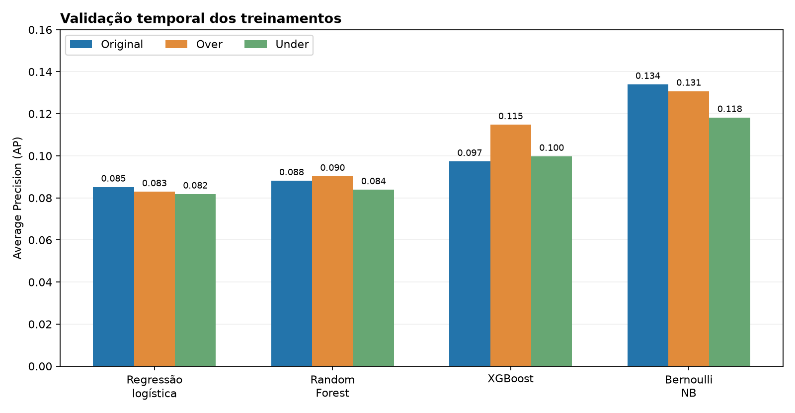
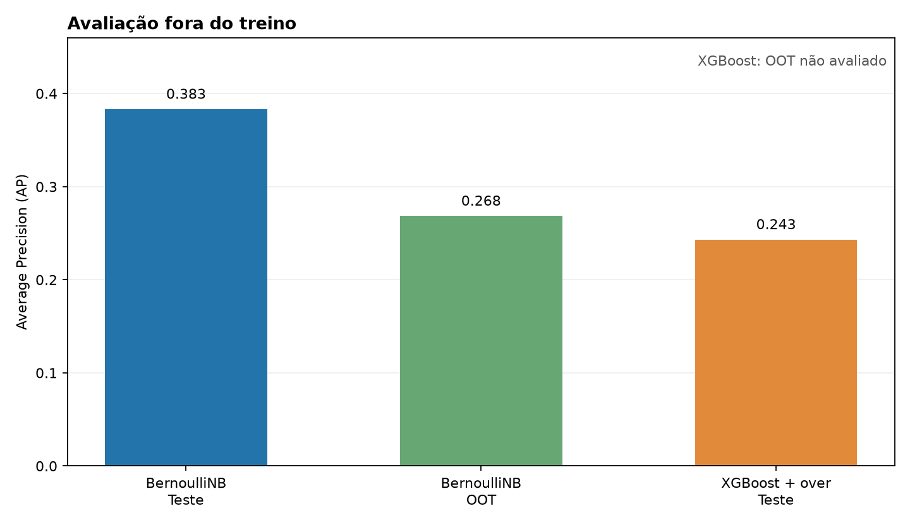

# FinComplaint ML

[Português](README.md) | [English](README.en.md)

A retrospective classification study to estimate the risk that a company will **not respond on time** to a financial complaint. The business goal would be to help prioritize complaint triage; this project **is not a production prediction system**.

## Data and target variable

The project uses a local CSV with the schema of the [CFPB Consumer Complaint Database](https://www.consumerfinance.gov/data-research/consumer-complaints/). The analyzed sample contains **555,957 complaints**, received from **December 1, 2011 to April 25, 2016**. The CSV is not versioned. The exact source and download date of this local file were not recorded; therefore, a new download of the public database should not be assumed to produce the same sample.

Expected file: `data/raw/consumer_complaints.csv`.

SHA-256 of the local sample used for the results below:

```text
df219bbcf0e8233f33eb83454ef9b3451adf471db29618acfb36d2dacc40ed3f  consumer_complaints.csv
```

The `late_response` target is derived from `timely_response`: `Yes → 0` (responded on time) and `No → 1` (did not respond on time). The current file contains **14,048 positive cases** (approximately 2.53%).

## Project workflow

```text
Raw CSV
  → cleaning, dates, duplicates, and target (src/preprocessing/clean.py)
  → data/interim/complaints_clean.parquet
  → calendar features and allowlisted feature set (src/features/build_abt.py)
  → data/processed/ABT.parquet
  → chronological Train / Test / OOT split (src/training/split.py)
  → pipelines, temporal search, and MLflow tracking (src/training/)
  → candidate evaluation on Test and OOT (src/evaluation/)
```

The ABT retains `date_received` to order and split the data, but this column is removed from `X` before training. The ten allowed features are `product`, `sub_product`, `issue`, `sub_issue`, `company`, `state`, `submitted_via`, `received_year`, `received_month`, and `received_dayofweek`. Company response fields, `timely_response`, and other post-event information are not included in `X`.

| Split | Period | Complaints | Late-response rate |
| --- | --- | ---: | ---: |
| Train | Dec 1, 2011–Apr 28, 2015 | 388,848 | 2.40% |
| Test | Apr 29, 2015–Oct 18, 2015 | 83,518 | 2.80% |
| OOT | Oct 19, 2015–Apr 25, 2016 | 83,591 | 2.85% |

Training compares Logistic Regression, Random Forest, XGBoost, and Bernoulli Naive Bayes, using original data, *oversampling*, or *undersampling*. Preprocessing and sampling are kept inside the pipeline. Hyperparameter search uses five temporal splits and selects the best configuration by **Average Precision (AP)**. MLflow stores parameters, metrics, and models. Test and OOT do not participate in `fit`.

## Observed results

Results recorded in the local `model-received` experiment on **November 15, 2026**, using a classification threshold of `0.5` for precision, recall, and F1:

| Model | Split | Average Precision | Precision | Recall | F1 |
| --- | --- | ---: | ---: | ---: | ---: |
| BernoulliNB (no sampling) | Test | 0.3832 | 0.1719 | 0.7449 | 0.2793 |
| BernoulliNB (no sampling) | OOT | 0.2685 | 0.1641 | 0.6287 | 0.2602 |
| XGBoost (*oversampling*) | Test | 0.2432 | 0.2463 | 0.2937 | 0.2679 |

The charts below were generated with Matplotlib from completed runs in the local MLflow database, with no synthetic data. The first shows AP from the temporal validation used for hyperparameter search; its values should not be directly compared with Test/OOT results.



The second chart shows only the splits that were actually evaluated. There is no OOT bar for XGBoost because that evaluation has not been run yet.



BernoulliNB AP dropped by **0.1147 points** from Test to OOT (about **29.9%** in relative terms). This limits conclusions about temporal generalization; it does not invalidate the study. **XGBoost was not evaluated on OOT** by the current script. AP uses probabilities and is independent of the `0.5` threshold. See the [detailed evaluation](reports/evaluation.md), including run IDs, confusion matrices, and limitations.

## Reproducing the workflow

Use **Python 3.11** and run commands from the repository root. Direct dependencies are pinned in `requirements.txt` to the versions observed in the environment used for the results above. The workflow depends on the local CSV with the stated checksum; another snapshot may produce different results.

```bash
python3.11 -m venv .venv
source .venv/bin/activate
python -m pip install -r requirements.txt
mkdir -p data/raw
```

Place the CSV at `data/raw/consumer_complaints.csv`. To verify the sample on macOS:

```bash
shasum -a 256 data/raw/consumer_complaints.csv
```

Start the MLflow server in one terminal, from the project root:

```bash
mlflow server --backend-store-uri sqlite:///mlflow.db --serve-artifacts --artifacts-destination ./mlartifacts --host 127.0.0.1 --port 5000
```

In another terminal, with the same environment activated and from the root directory:

```bash
python src/preprocessing/clean.py
python src/features/build_abt.py
python src/training/train.py
python src/evaluation/run_evaluation.evalueate.py
python src/evaluation/plot_results.py
```

Training runs 12 model-and-sampling configurations, each with temporal search, and may take a while. The evaluation script selects the most recent completed runs for `BernoulliNB_original` and `XGBoost_over`, evaluates both on Test, and evaluates only `BernoulliNB_original` on OOT. The final command recreates the charts from `mlflow.db` without retraining.

## Limitations and repository organization

- The [CFPB public database](https://www.consumerfinance.gov/complaint/data-use/) publishes complaints **after the company responds or after 15 days**. Therefore, this retrospective snapshot does not establish that the published values of `company`, `issue`, and `sub_issue` would have been available exactly at `date_received`. An operational application must confirm which values are available at that time.
- The drop in OOT AP shows that Test performance should not be treated as guaranteed future performance. These results come from this historical sample and do not represent all complaints in the market.
- CSVs, Parquet files, the SQLite database, and local MLflow artifacts are generated or obtained outside the code and ignored by Git. The report preserves the observed results; exact reproduction depends on using the same sample and versions, and the workflow was not rerun as part of this documentation.

## License

The code in this project is available under the [MIT License](LICENSE). The license applies to the project code; CFPB data and dependencies retain their own terms.
