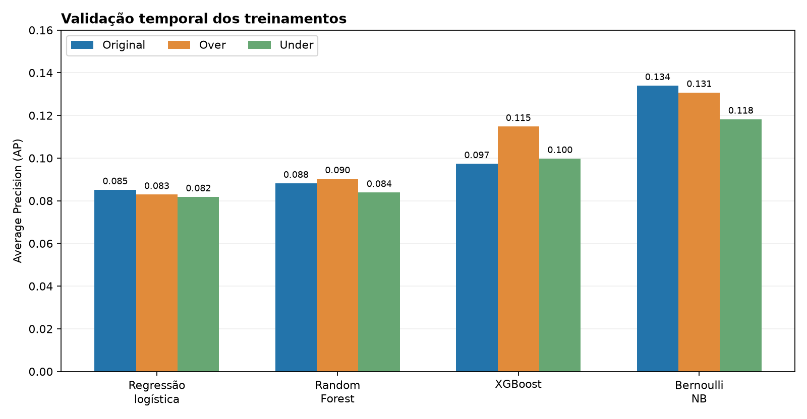
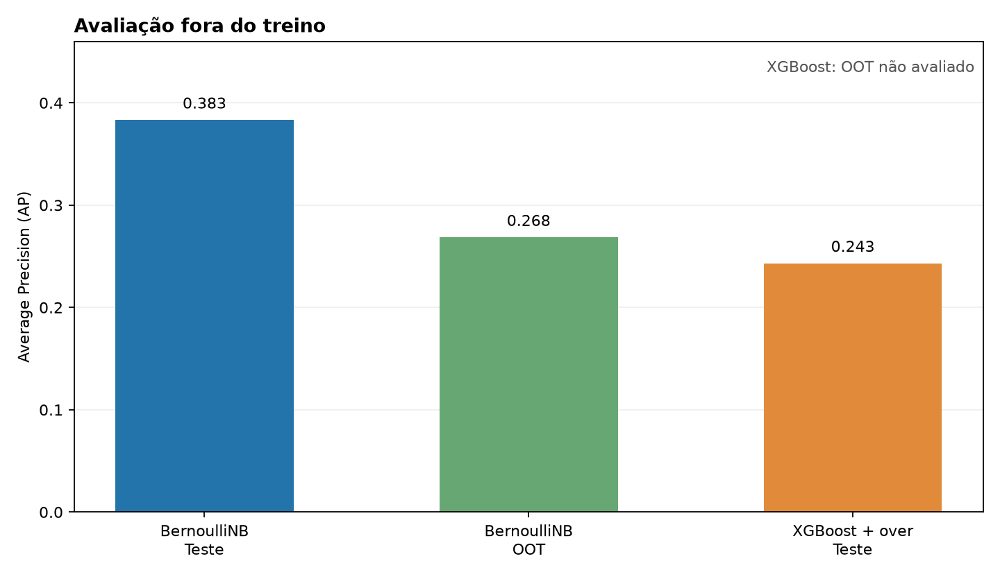

# FinComplaint ML

Estudo retrospectivo de classificação para estimar o risco de uma empresa **não responder no prazo** a uma reclamação financeira. O objetivo de negócio seria ajudar a priorizar a triagem de reclamações; o projeto **não é um sistema de previsão em produção**.

## Dados e variável-alvo

O projeto usa um CSV local com o esquema da [Consumer Complaint Database do CFPB](https://www.consumerfinance.gov/data-research/consumer-complaints/). A amostra analisada contém **555.957 reclamações**, recebidas de **01/12/2011 a 25/04/2016**. O CSV não é versionado. A origem exata e a data de download deste arquivo local não foram registradas; portanto, não se deve presumir que um novo download do banco público produza a mesma amostra.

Arquivo esperado: `data/raw/consumer_complaints.csv`.

SHA-256 da amostra local usada nos resultados abaixo:

```text
df219bbcf0e8233f33eb83454ef9b3451adf471db29618acfb36d2dacc40ed3f  consumer_complaints.csv
```

A variável `late_response` é construída a partir de `timely_response`: `Yes → 0` (respondeu no prazo) e `No → 1` (não respondeu no prazo). No arquivo atual, há **14.048 casos positivos** (aproximadamente 2,53%).

## Fluxo do projeto

```text
CSV bruto
  → limpeza, datas, duplicatas e alvo (src/preprocessing/clean.py)
  → data/interim/complaints_clean.parquet
  → variáveis de calendário e lista permitida de features (src/features/build_abt.py)
  → data/processed/ABT.parquet
  → divisão cronológica Treino / Teste / OOT (src/training/split.py)
  → pipelines, busca temporal e registro no MLflow (src/training/)
  → avaliação dos candidatos no Teste e no OOT (src/evaluation/)
```

A ABT mantém `date_received` para ordenar e dividir os dados, mas essa coluna é retirada de `X` antes do treino. As dez features permitidas são `product`, `sub_product`, `issue`, `sub_issue`, `company`, `state`, `submitted_via`, `received_year`, `received_month` e `received_dayofweek`. Campos de resposta da empresa, `timely_response` e outras informações posteriores não entram em `X`.

| Conjunto | Período | Reclamações | Taxa de atraso |
| --- | --- | ---: | ---: |
| Treino | 01/12/2011–28/04/2015 | 388.848 | 2,40% |
| Teste | 29/04/2015–18/10/2015 | 83.518 | 2,80% |
| OOT | 19/10/2015–25/04/2016 | 83.591 | 2,85% |

O treino compara Regressão Logística, Random Forest, XGBoost e Bernoulli Naive Bayes, com dados originais, *oversampling* ou *undersampling*. Pré-processamento e amostragem ficam dentro do pipeline. A busca de hiperparâmetros usa cinco divisões temporais e escolhe o melhor ajuste por **Average Precision (AP)**. O MLflow guarda parâmetros, métricas e modelos. Teste e OOT não participam do `fit`.

## Resultados observados

Resultados registrados no experimento local `model-received` em **15/11/2026**, com limiar de classificação `0,5` para precision, recall e F1:

| Modelo | Conjunto | Average Precision | Precision | Recall | F1 |
| --- | --- | ---: | ---: | ---: | ---: |
| BernoulliNB (sem amostragem) | Teste | 0,3832 | 0,1719 | 0,7449 | 0,2793 |
| BernoulliNB (sem amostragem) | OOT | 0,2685 | 0,1641 | 0,6287 | 0,2602 |
| XGBoost (*oversampling*) | Teste | 0,2432 | 0,2463 | 0,2937 | 0,2679 |

Os gráficos abaixo foram gerados com Matplotlib a partir das métricas dos runs concluídos no MLflow local, sem dados sintéticos. O primeiro mostra a AP da validação temporal usada na busca de hiperparâmetros; seus valores não devem ser comparados diretamente aos de Teste/OOT.



O segundo mostra apenas os conjuntos efetivamente avaliados. Não há barra de OOT para XGBoost porque essa avaliação ainda não foi executada.



A AP do BernoulliNB caiu **0,1147 ponto** do Teste para o OOT (cerca de **29,9%** em termos relativos). Isso limita a interpretação da capacidade de generalização temporal; não invalida o estudo. O XGBoost **não foi avaliado no OOT** pelo script atual. AP usa probabilidades e independe do limiar `0,5`. Veja [a avaliação detalhada](reports/evaluation.md), incluindo IDs dos runs, matriz de confusão e limitações.

## Como reproduzir o fluxo

Use **Python 3.11** e execute os comandos a partir da raiz do repositório. As dependências diretas estão fixadas em `requirements.txt` nas versões observadas no ambiente dos resultados acima. O fluxo depende do CSV local com o checksum informado; outro snapshot pode gerar resultados diferentes.

```bash
python3.11 -m venv .venv
source .venv/bin/activate
python -m pip install -r requirements.txt
mkdir -p data/raw
```

Coloque o CSV em `data/raw/consumer_complaints.csv`. Para conferir a amostra no macOS:

```bash
shasum -a 256 data/raw/consumer_complaints.csv
```

Inicie o servidor MLflow em um terminal, ainda na raiz do projeto:

```bash
mlflow server --backend-store-uri sqlite:///mlflow.db --serve-artifacts --artifacts-destination ./mlartifacts --host 127.0.0.1 --port 5000
```

Em outro terminal, com o mesmo ambiente ativado e a partir da raiz:

```bash
python src/preprocessing/clean.py
python src/features/build_abt.py
python src/training/train.py
python src/evaluation/run_evaluation.evalueate.py
python src/evaluation/plot_results.py
```

O treinamento executa 12 combinações de modelo e amostragem, cada uma com busca temporal, e pode demorar. O script de avaliação escolhe os runs concluídos mais recentes de `BernoulliNB_original` e `XGBoost_over`, mede ambos no Teste e apenas `BernoulliNB_original` no OOT. O último comando recria os gráficos a partir de `mlflow.db`, sem treinar novamente.

## Limitações e organização

- A [base pública do CFPB](https://www.consumerfinance.gov/complaint/data-use/) publica reclamações **após a resposta da empresa ou 15 dias**. Assim, este snapshot retrospectivo não demonstra que os valores publicados de `company`, `issue` e `sub_issue` estariam disponíveis exatamente em `date_received`. Uma aplicação operacional precisa confirmar os valores disponíveis naquele instante.
- A queda de AP no OOT mostra que o desempenho no Teste não deve ser tratado como desempenho futuro garantido. Os resultados são desta amostra histórica e não representam todas as reclamações do mercado.
- CSV, Parquets, banco SQLite e artefatos locais do MLflow são gerados/obtidos fora do código e ignorados pelo Git. O relatório preserva os resultados observados; a reprodução exata depende da mesma amostra e das mesmas versões, e não foi reexecutada como parte da documentação.
